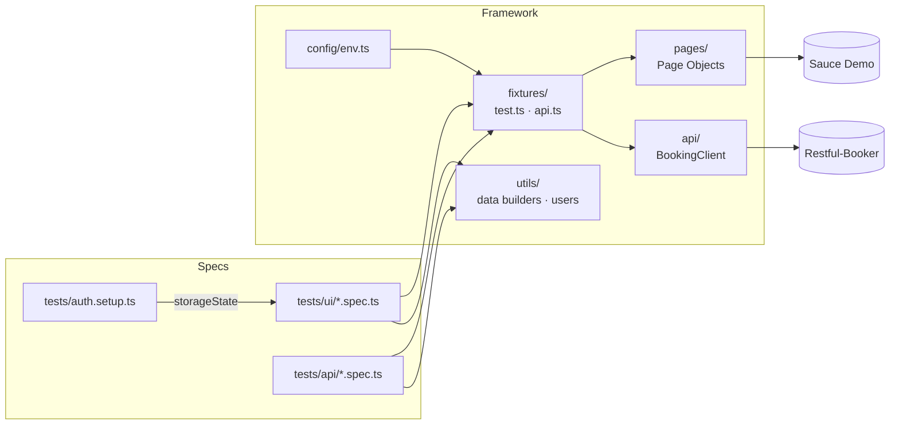

# Playwright + TypeScript E2E Framework

[](https://github.com/Mariya2880/playwright-ts-e2e-framework/actions/workflows/ci.yml)


UI and API test automation framework built with **Playwright** and **TypeScript**, structured the way I'd set it up for a product team: page objects behind fixtures, tests at the right level, generated data, and a CI pipeline that gates every pull request.

| System under test | Covered |
| --- | --- |
| [Sauce Demo](https://www.saucedemo.com) (web UI) | Login, products and sorting, product details, cart, 3-step checkout, full purchase journey, accessibility |
| [Restful-Booker](https://restful-booker.herokuapp.com) (REST API) | Auth, booking CRUD lifecycle, filtering, 404s, authorisation enforcement, response contracts |

📄 **[Test strategy](docs/TEST-STRATEGY.md)**: scope, risk-based priorities, test levels, data and CI tiers.

## Highlights

- **Fixtures, not boilerplate.** Page objects and API clients are injected into tests, so specs read as behaviour.
- **Log in once.** A setup project saves the session (`storageState`) and UI tests reuse it. Login itself is tested separately.
- **Independent oracles.** Sort orders and checkout totals (subtotal + 8% tax) are *calculated* by the test, not copied from the app.
- **API contract checks.** Every response is validated against a strict `zod` schema with a custom `toMatchSchema` matcher, so a missing, renamed, extra or wrongly typed field fails with the exact path. The client's TypeScript types are derived from the same schemas.
- **Security checks on the API.** Write calls with no, empty or forged tokens must return 403, and the test re-reads the data to prove nothing changed.
- **Accessibility.** axe-core scans key pages against WCAG 2.1 AA.
- **Known bugs documented in code.** Defects are captured as `test.fail()` tests linked to GitHub issues.
- **Tiered CI.** Chromium UI and API tests on every PR; Firefox and WebKit regression nightly.
- **Flake prevention.** ESLint blocks hard waits, `test.only` and `force: true`; traces are captured on retry.

## Architecture



```
├── .github/workflows/ci.yml   # Lint → tests on PR; cross-browser nightly
├── api/                       # Typed API clients + response schemas
├── config/env.ts              # Environment config (TEST_ENV)
├── docs/TEST-STRATEGY.md
├── fixtures/                  # Page object + API fixtures
├── pages/                     # Page Object Model, one class per page
├── tests/
│   ├── auth.setup.ts          # Logs in once, saves session
│   ├── api/                   # API tests (no browser)
│   └── ui/                    # Browser tests
└── utils/                     # Faker builders, test users, helpers
```

## Running locally

```bash
npm ci
npx playwright install --with-deps chromium
npm test                                   # UI (Chromium) + API
npx playwright test --grep @smoke          # critical path only
npx playwright test --project=api          # API only
npx playwright test --grep @contract       # contract-check self-tests (offline)
CROSS_BROWSER=1 npx playwright test        # + Firefox and WebKit
npm run report                             # open the HTML report
```

## Key design decisions

| Decision | Why |
| --- | --- |
| Retries 0 locally, 2 in CI | Flaky tests fail loudly during development |
| `trace: on-first-retry` | Every CI failure comes with a Trace Viewer recording |
| Locators: role → placeholder → `data-test` | Resilient to styling changes, mirrors how users find elements |
| Separate `api` project | API tests skip browser start-up and run in parallel with UI tests |
| Self-cleaning API fixture | Each test owns its data on a shared public API |
| Strict response schemas | Catches contract drift that `toMatchObject` lets through (extra fields, numbers as strings); types come from the schemas, so they can't drift either |
| Wait for page-specific elements | Sauce Demo is a SPA where the URL changes before the DOM |

## What I'd add next

- Enforce accessibility: fail on any violation not in a reviewed known-issues list
- Visual regression snapshots for key pages, with baselines generated in CI
- Sharding across CI machines with merged reports as the suite grows
- Publishing the HTML report to GitHub Pages

## Author

**Mariya Tony Konikkara**, QA Automation Engineer, Berlin · [LinkedIn](https://www.linkedin.com/in/mariya-tony-konikkara)
